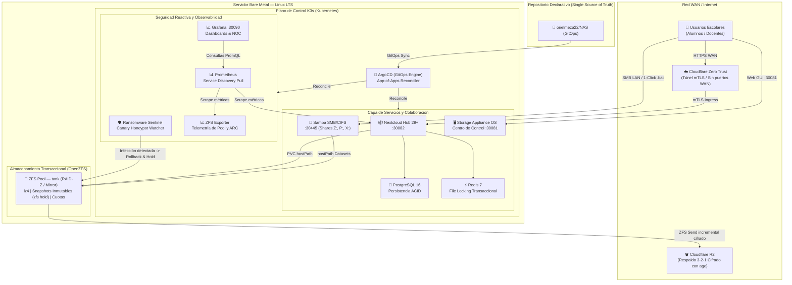

# Enterprise Educational NAS — Cloud-Native Storage & Collaboration Platform

[](https://k3s.io/)
[](https://argo-cd.readthedocs.io/)
[](https://openzfs.org/)
[](https://www.postgresql.org/)
[](https://redis.io/)
[](https://grafana.com/)
[](https://www.cloudflare.com/zero-trust/)
[](LICENSE)

Repositorio de **Infraestructura como Código (IaC)** para el despliegue automatizado, operación, resiliencia y observabilidad de un servidor de almacenamiento en red (NAS) y plataforma de colaboración institucional para entornos educativos.

La arquitectura reemplaza los servidores de archivos monolíticos tradicionales por un plano de control declarativo orquestado por **K3s (Kubernetes)** y **ArgoCD (GitOps)**, respaldado a nivel de hardware por almacenamiento transaccional **OpenZFS**, protegido con un **Escudo Anti-Ransomware reactivo**, respaldado de forma externa en **Cloudflare R2 (3-2-1)** y expuesto mediante **Cloudflare Zero Trust** sin abrir puertos en la red perimetral del establecimiento.

---

## Tabla de Contenidos

- [Arquitectura y Topología del Sistema](#arquitectura-y-topología-del-sistema)
- [Especificaciones del Stack Tecnológico](#especificaciones-del-stack-tecnológico)
- [Decisiones de Ingeniería (ADR)](#decisiones-de-ingeniería-adr)
- [Estructura del Repositorio](#estructura-del-repositorio)
- [Guía de Aprovisionamiento e Instalación](#guía-de-aprovisionamiento-e-instalación)
- [Validación Automatizada (Smoke Tests)](#validación-automatizada-smoke-tests)
- [Operación, Backups y Recuperación ante Desastres](#operación-backups-y-recuperación-ante-desastres)
- [Centro de Control: SMB, Identidades y Conector Windows](#centro-de-control-smb-identidades-y-conector-windows)
- [Autoría y Licencia](#autoría-y-licencia)

---

## Arquitectura y Topología del Sistema

El sistema se divide en cuatro planos aislados: **Acceso y Seguridad Perimetral**, **Orquestación de Aplicaciones**, **Seguridad y Observabilidad SRE** y **Persistencia en Disco (OpenZFS)**.



---

## Especificaciones del Stack Tecnológico

| Capa | Tecnología | Versión | Función |
|---|---|---|---|
| **Host OS** | Debian / Ubuntu Server LTS | 12 / 22.04 / 24.04 | Sistema operativo base con kernel ZFS nativo. |
| **Orquestación** | K3s | v1.31+ | Kubernetes ligero (~512 MB RAM footprint, containerd). |
| **GitOps** | ArgoCD | v2.13+ | Reconciliación continua y declarativa de infraestructura (Git → Clúster). |
| **Almacenamiento** | OpenZFS | 2.2+ | Copy-on-Write, compresión inline LZ4, snapshots atómicos, cuotas y autorreparación. |
| **File Sharing** | Samba (SMB/CIFS) | 4.12+ | Compartición de red Windows/macOS/Linux (`[profesores]`, `[alumnos]`, `[publico]`, `[nextcloud]`). |
| **Colaboración** | Nextcloud Hub | 29+ | Suite cloud escolar: WebDAV, Calendario, Documentos y sincronización multi-dispositivo. |
| **Base de Datos** | PostgreSQL | 16-alpine | Base relacional ACID dedicada para Nextcloud, eliminando bloqueos de SQLite. |
| **Caché & Locking** | Redis | 7-alpine | Caché de consultas en memoria y broker transaccional de bloqueo de archivos en red. |
| **Centro de Control** | NAS Appliance OS | Python 3.11 / SPA | Portal web multihilo (`:30081`) para gobernanza de ZFS, SMB, K3s, identidades y red WAN. |
| **Ciberseguridad** | Ransomware Sentinel | K8s Daemon | Vigilancia en tiempo real de trampas Canary Honeypot y congelamiento con `zfs hold`. |
| **Métricas** | Prometheus + ZFS Exporter | v2.54+ / v2.3+ | Recolección de telemetría de CPU, RAM, I/O de disco y estado del pool ZFS/ARC. |
| **Dashboards** | Grafana | v11+ | Paneles visuales NOC de observabilidad, alertas y estado de subsistemas. |
| **Acceso Seguro** | Cloudflare Zero Trust | cloudflared | Túnel mTLS cifrado sin requerir IP pública fija ni apertura de puertos perimetrales. |
| **Backup Offsite** | Cloudflare R2 | S3 API | Respaldo 3-2-1 externo mediante streams incrementales ZFS cifrados en origen con `age`. |
| **Cliente Windows** | Conector 1-Click | Batch (.bat) | Script público interactivo para montaje instantáneo de unidades (`Z:`, `P:`, `X:`). |

---

## Decisiones de Ingeniería (ADR)

| # | Decisión | Justificación |
|---|---|---|
| **ADR-001** | **K3s sobre K8s vanilla** | Menor footprint de memoria (~512 MB RAM); binario único; certificados auto-rotados. Ideal para hardware educativo y servidores dedicados. |
| **ADR-002** | **ArgoCD como controlador GitOps** | Reconciliación continua del estado declarado en Git vs. el clúster. Elimina `kubectl apply` manuales y previene la desviación de configuración (*drift*). |
| **ADR-003** | **ZFS sobre LVM/mdraid** | Copy-on-Write, checksums de 256 bits contra degradación silenciosa (*bit-rot*), snapshots instantáneos, compresión LZ4 en caliente y cuotas estrictas. |
| **ADR-004** | **Cloudflare Zero Trust** | Exposición WAN mediante túnel seguro saliente mTLS. Elimina la necesidad de IP pública estática y mitiga ataques de sondeo o escaneo de puertos. |
| **ADR-005** | **Prometheus + Grafana + ZFS Exporter** | Observabilidad SRE integral. Monitoreo en tiempo real del tamaño de caché ARC, tasa de aciertos (*ARC hit-rate*), I/O de vdevs y rendimiento de pods. |
| **ADR-006** | **Nextcloud como hub de colaboración** | Almacenamiento escolar privado con soporte WebDAV, control de versiones de archivos, cuotas por usuario y gestión de permisos institucionales. |
| **ADR-007** | **Samba para acceso SMB/CIFS nativo** | Integración transparente con el Explorador de Archivos de Windows mediante shares por rol (`[profesores]`, `[alumnos]`, `[publico]`). |
| **ADR-008** | **Helm charts y manifiestos K8s** | Modularidad de despliegue: aplicaciones de terceros gestionadas con Helm (`kube-prometheus-stack`), y microservicios propios mediante manifiestos declarativos. |
| **ADR-009** | **Patrón App-of-Apps (ArgoCD)** | Orquestación completa del clúster a partir de un único punto de entrada (`infrastructure/root-application.yaml`), garantizando despliegues repetibles y atómicos. |
| **ADR-010** | **Defense-in-Depth con NetworkPolicies** | Microsegmentación Zero-Trust de capas 3 y 4. Tráfico SMB restringido y Portal QR con políticas de aislamiento perimetral. |
| **ADR-011** | **Gestión de Secretos con Bitnami Sealed Secrets** | Cifrado asimétrico de credenciales para versionado seguro en repositorios Git públicos o privados sin exposición de secretos en texto plano. |
| **ADR-012** | **PostgreSQL 16 + Redis 7 para Nextcloud** | Desacoplamiento de la base interna (SQLite) hacia PostgreSQL 16 y Redis 7 para soportar alta concurrencia de alumnos y bloqueo transaccional de archivos. |
| **ADR-013** | **ThreadedHTTPServer y Resiliencia en Sondas K3s** | Arquitectura multihilo en el backend del Portal QR (`server.py`) y relajación de sondas K8s (`timeoutSeconds: 5`, `failureThreshold: 5`) para evitar caídas en picos de I/O. |
| **ADR-014** | **Escudo Anti-Ransomware Reactivo (Sentinel)** | Detección automatizada de anomalías en archivos trampa (`.canary_honeypot.docx`) con reversión automática a snapshots limpios y congelamiento mediante `zfs hold`. |
| **ADR-015** | **Estrategia de Backup 3-2-1 a Cloudflare R2** | Exportación de snapshots incrementales ZFS cifrados en origen con el estándar criptográfico moderno `age` hacia almacenamiento de objetos S3 fuera del centro de datos. |
| **ADR-016** | **Aprovisionamiento Unificado y Conector 1-Click** | Creación simultánea de identidades en Nextcloud (`occ`) y Samba (`smbpasswd`), acompañada de un script `.bat` autodescargable que mapea unidades de red sin usar la terminal. |

---

## Estructura del Repositorio

```text
NAS/
├── .github/
│   └── workflows/
│       └── validate.yml               # CI: Validación sintáctica de YAMLs y escaneo de secretos
├── apps/
│   ├── grafana/                       # Observabilidad: Prometheus + Grafana (Helm)
│   │   ├── alerts-cm.yaml             # Reglas de alerta para Alertmanager
│   │   ├── dashboard-cm.yaml          # Paneles de control aprovisionados as-code
│   │   ├── Chart.yaml & values.yaml   # Configuración de kube-prometheus-stack
│   │   └── sealed-secret.yaml         # Credenciales de administración cifradas
│   ├── nextcloud/                     # Suite de colaboración y almacenamiento web
│   │   ├── database-redis.yaml        # Despliegue de PostgreSQL 16 y Redis 7
│   │   ├── pv.yaml & pvc.yaml         # Volúmenes persistentes atados al dataset ZFS
│   │   ├── service.yaml               # NodePort :30082
│   │   └── values.yaml                # Configuración de Nextcloud Hub
│   ├── portal-qr/                     # Centro de Control OS Appliance (NodePort :30081)
│   │   ├── server.py                  # API multihilo en Python 3.11 con control de hostPID
│   │   ├── static/index.html          # Interfaz SPA moderna estilo Proxmox/TrueNAS
│   │   ├── deployment.yaml            # Pod con privilegios administrativos del host
│   │   ├── configmap.yaml             # Manifiesto ConfigMap generado del código
│   │   ├── networkpolicy.yaml         # Restricciones de tráfico perimetral
│   │   └── service.yaml               # NodePort :30081
│   └── samba/                         # Servidor de archivos de red local (SMB/CIFS)
│       ├── deployment.yaml            # Contenedor Samba con extensiones VFS y papelera
│       ├── pv.yaml & pvc.yaml         # Mapeo de datasets ZFS independientes
│       ├── service.yaml               # NodePort :30445 y exposición LAN :445
│       └── networkpolicy.yaml         # Reglas de filtrado de tráfico SMB
├── docs/
│   ├── RFC-001-Enterprise-NAS-Architecture.md  # Especificación técnica formal y modelo SRE
│   ├── DISASTER_RECOVERY_RUNBOOK.md            # Plan de contingencia, RPO/RTO y simulacros
│   └── SAMBA_Y_CONECTOR.md                     # Manual operativo de SMB, cuotas y script cliente
├── infrastructure/                    # Manifiestos de orquestación GitOps (ArgoCD)
│   ├── root-application.yaml          # Aplicación raíz del patrón App-of-Apps
│   ├── nextcloud-app.yaml             # Aplicación hija para Nextcloud
│   ├── samba-app.yaml                 # Aplicación hija para Samba
│   ├── portal-app.yaml                # Aplicación hija para Portal QR
│   ├── ransomware-sentinel.yaml       # DaemonSet centinela de detección de ransomware
│   ├── zfs-exporter.yaml              # Exportador de métricas OpenZFS a Prometheus
│   ├── zfs-snapshot-cronjob.yaml      # Automatización de snapshots locales programados
│   ├── zfs-offsite-backup-cronjob.yaml# Respaldo incremental cifrado hacia Cloudflare R2
│   ├── zfs-quotas-enforcer.yaml       # Validador y guardián de cuotas por dataset
│   └── zfs-scrub-cronjob.yaml         # Verificación periódica de integridad del pool
├── scripts/
│   ├── bootstrap-enterprise-nas.sh    # Aprovisionamiento automatizado bare-metal
│   └── nas-recover.sh                 # Restauración exprés ante desastres desde R2/ZFS
├── tests/
│   ├── smoke-test.sh                  # Suite de validación de 18 pruebas automáticas
│   └── disaster-recovery-drill.sh     # Simulacro de inyección de fallos y recuperación
├── Makefile                           # Comandos operacionales estandarizados
├── CONTRIBUTING.md
├── SECURITY.md
└── LICENSE
```

---

## Guía de Aprovisionamiento e Instalación

### Prerrequisitos del Host

| Componente | Requisito Mínimo | Recomendado |
|---|---|---|
| **CPU** | 2 cores x86_64 | 4+ cores x86_64 |
| **RAM** | 4 GB | 8+ GB (permite mayor asignación de caché ZFS ARC) |
| **Discos** | 2x Discos (Mirror o RAID-Z) | 1x SSD (SO) + 2x o más Discos de datos en ZFS |
| **Sistema Operativo** | Debian 12 / Ubuntu 22.04 LTS | Debian 12 / Ubuntu 24.04 LTS |
| **Conectividad** | 1 Gbps LAN | 1 Gbps LAN + conexión a internet para túnel Zero Trust |

### Paso 1 — Inicializar el Pool y Datasets OpenZFS

```bash
# 1. Instalar herramientas ZFS en el host
sudo apt update && sudo apt install -y zfsutils-linux

# 2. Crear el pool de almacenamiento con redundancia (ejemplo mirror con /dev/sdb y /dev/sdc)
sudo zpool create -f -o ashift=12 tank mirror /dev/sdb /dev/sdc

# 3. Aplicar directivas de rendimiento empresarial
sudo zfs set compression=lz4 tank
sudo zfs set atime=off tank
sudo zfs set xattr=sa tank

# 4. Crear datasets departamentales con gobernanza de cuotas
sudo zfs create tank/nas
sudo zfs create tank/nas/profesores
sudo zfs set quota=10G tank/nas/profesores

sudo zfs create tank/nas/alumnos
sudo zfs set quota=5G tank/nas/alumnos

sudo zfs create tank/nas/publico
sudo zfs set quota=5G tank/nas/publico

sudo zfs create tank/nas/nextcloud
```

### Paso 2 — Instalar K3s (Kubernetes Edge)

```bash
# Desplegar K3s desactivando Traefik (utilizamos ingress nativo y Cloudflare Tunnel)
curl -sfL https://get.k3s.io | INSTALL_K3S_EXEC="--disable traefik" sh -

# Validar que el nodo esté en estado Ready
sudo kubectl get nodes
```

### Paso 3 — Desplegar ArgoCD

```bash
# Crear namespace y aplicar manifiesto oficial estable
sudo kubectl create namespace argocd
sudo kubectl apply -n argocd -f https://raw.githubusercontent.com/argoproj/argo-cd/v2.13.2/manifests/install.yaml

# Obtener la contraseña de primer inicio del usuario admin
sudo kubectl -n argocd get secret argocd-initial-admin-secret -o jsonpath="{.data.password}" | base64 -d && echo ""
```

### Paso 4 — Configuración Inicial de Secretos

```bash
# Credenciales maestras de Nextcloud
sudo kubectl create secret generic nextcloud-admin-credentials \
  --from-literal=username=admin \
  --from-literal=password='PasswordSegura2026!'

# Usuarios base de Samba (profesores, alumnos y administración técnica)
sudo kubectl create secret generic samba-credentials \
  --from-literal=user-profesores='profesor01;ProfesorPass2026!' \
  --from-literal=user-alumnos='alumno01;AlumnoPass2026!' \
  --from-literal=user-admin='admin.it;AdminItPass2026!'

# Credenciales de monitoreo Grafana
sudo kubectl create namespace monitoring
sudo kubectl -n monitoring create secret generic grafana-admin-credentials \
  --from-literal=admin-user=admin \
  --from-literal=admin-password='PasswordSegura2026!'
```

### Paso 5 — Despliegue de la Plataforma (App-of-Apps)

Un solo comando aplica la `Root Application` de ArgoCD, la cual sincroniza y levanta automáticamente Nextcloud (con PostgreSQL 16 y Redis 7), Samba, el Centro de Control OS, Prometheus, Grafana, los Centinelas Anti-Ransomware y las tareas cron:

```bash
sudo kubectl apply -f infrastructure/root-application.yaml

# Supervisar el estado de sincronización de todas las aplicaciones
sudo kubectl -n argocd get applications
```

---

## Validación Automatizada (Smoke Tests)

El repositorio incluye una batería de pruebas de aceptación y verificación SRE para comprobar la integridad de todo el clúster:

```bash
chmod +x tests/smoke-test.sh
./tests/smoke-test.sh
```

El script valida automáticamente:
1. Estado del pool OpenZFS (`tank`) y datasets montados.
2. Salud de los pods de K3s (`nextcloud`, `nextcloud-postgres`, `nextcloud-redis`, `portal-qr`, `samba`, `ransomware-sentinel`, `zfs-exporter`).
3. Conectividad a la base de datos PostgreSQL y caché Redis.
4. Respuesta HTTP 200 en los endpoints de Nextcloud, Grafana y el Centro de Control.
5. Descarga íntegra del conector `.bat` de Samba.
6. Estado del túnel Cloudflare Zero Trust.

---

## Operación, Backups y Recuperación ante Desastres

### Snapshots ZFS Automáticos y Retención

Un `CronJob` de Kubernetes crea snapshots atómicos nocturnos y gestiona la retención histórica:

```bash
# Listar snapshots existentes en el sistema
sudo zfs list -t snapshot

# Generar un snapshot manual inmediato
sudo zfs snapshot tank/nas@manual-$(date +%Y%m%d-%H%M)

# Revertir el estado del almacenamiento (Rollback atómico)
sudo zfs rollback tank/nas@nombre-del-snapshot
```

### Estrategia de Respaldo 3-2-1 a Cloudflare R2

El cronjob `infrastructure/zfs-offsite-backup-cronjob.yaml` toma snapshots incrementales de los datasets de datos, los comprime y cifra en caliente con **`age`** y los envía mediante API S3 al bucket de **Cloudflare R2**:

```bash
# Ejecutar respaldo manual fuera de sitio
sudo /bin/bash scripts/bootstrap-enterprise-nas.sh --trigger-backup
```

### Matriz de Puertos y Puntos de Acceso

| Servicio | Ámbito | URL / Protocolo | Puerto |
|---|---|---|---|
| **Centro de Control (Appliance OS)** | LAN / Local | `http://<IP_NAS>:30081` | 30081 (NodePort) |
| **Nextcloud Hub** | WAN (Zero Trust) / LAN | `https://<TUNNEL_DOMAIN>` o `http://<IP_NAS>:30082` | 30082 / HTTPS 443 |
| **Samba (Archivos Windows)** | Red Local (LAN) | `smb://<IP_NAS>` | 445 / 30445 |
| **Grafana NOC** | LAN / Gestión | `http://<IP_NAS>:30090` | 30090 (NodePort) |
| **ArgoCD GitOps** | LAN / Gestión | `http://<IP_NAS>:8080` (vía port-forward) | 8080 |

### Procedimiento de Recuperación ante Desastres (DRP)

En caso de fallo total de hardware:
1. **Reinstalar el sistema operativo base** (Debian 12 o Ubuntu LTS).
2. **Importar el pool ZFS existente** (`sudo zpool import tank`). Si los discos físicos se perdieron, restaurar desde el bucket R2 con el script `scripts/nas-recover.sh`.
3. **Instalar K3s y ArgoCD** (Pasos 2 y 3 de la guía).
4. **Recrear secretos iniciales** (Paso 4).
5. **Aplicar la Root Application**: `sudo kubectl apply -f infrastructure/root-application.yaml`. ArgoCD reconstruirá el 100% de los microservicios y configuraciones en minutos.

> Documentación de contingencia detallada: [`docs/DISASTER_RECOVERY_RUNBOOK.md`](docs/DISASTER_RECOVERY_RUNBOOK.md).

---

## Centro de Control: SMB, Identidades y Conector Windows

El Centro de Control del NAS (`apps/portal-qr`, puerto NodePort `30081`) ofrece una consola unificada para la gestión del almacenamiento:

- **Gobernanza de Recursos SMB:** Ajuste dinámico de cuotas ZFS en caliente para los departamentos `[profesores]`, `[alumnos]`, `[publico]` y `[nextcloud]`.
- **Auditoría de Sesiones SMB:** Supervisión en tiempo real de clientes Windows conectados y archivos bloqueados mediante integración con `smbstatus`.
- **Directorio de Cuentas Escolar:** Alta, baja y cambio de contraseñas de manera simultánea en Nextcloud (`occ user:*`) y en Samba (`smbpasswd`), con soporte para aprovisionamiento masivo mediante planillas CSV.
- **Conector 1-Click para Windows (`Conectar-Unidad-NAS.bat`):** Permite a alumnos y profesores descargar desde la web un archivo autoejecutable que solicita credenciales y monta de inmediato las unidades institucionales (`Z: Alumnos`, `P: Profesores`, `X: Público`) en el Explorador de Archivos de Windows, sin necesidad de comandos de consola.
- **Supervisión de Microservicios K3s:** Inspección visual de salud y visualizador de registros (*logs*) de los 7 pods nucleares de la plataforma.

> Guía técnica y referencia de la API del portal: [`docs/SAMBA_Y_CONECTOR.md`](docs/SAMBA_Y_CONECTOR.md).

---

## Autoría y Licencia

**Oriel Meza** — Trabajo de Fin de Grado (TFG)  
Ingeniería / Infraestructura Cloud & Almacenamiento

- GitHub: [@orielmeza22](https://github.com/orielmeza22)
- Repositorio del Proyecto: [github.com/orielmeza22/NAS](https://github.com/orielmeza22/NAS)

Este proyecto se distribuye bajo la licencia **MIT**. Consulte el archivo [LICENSE](LICENSE) para más detalles.
