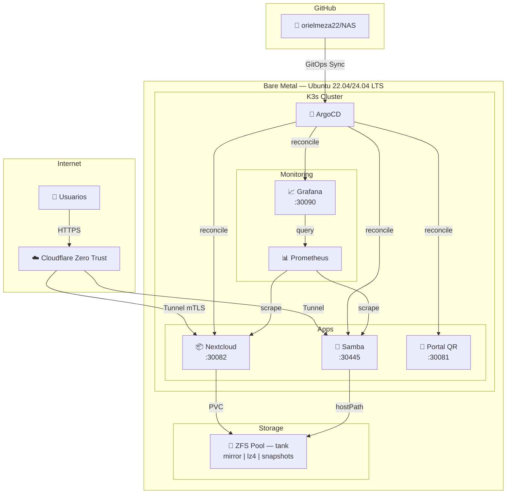

# Enterprise Educational NAS — Cloud-Native Storage & Collaboration Platform

[](https://k3s.io/)
[](https://argo-cd.readthedocs.io/)
[](https://openzfs.org/)
[](https://grafana.com/)
[](https://www.cloudflare.com/zero-trust/)
[](https://ubuntu.com/)
[](LICENSE)

Repositorio de **Infraestructura como Código (IaC)** para el despliegue automatizado, operación y observabilidad de un servidor de almacenamiento en red (NAS) y plataforma de colaboración institucional.

La arquitectura reemplaza los servidores de archivos monolíticos tradicionales por un plano de control declarativo basado en **K3s (Kubernetes)** y **ArgoCD**, respaldado a nivel físico por almacenamiento transaccional **OpenZFS** y expuesto de forma segura mediante túneles **Zero Trust** sin apertura de puertos en la red escolar.

---

## Tabla de Contenidos

- [Arquitectura y Topología del Sistema](#arquitectura-y-topología-del-sistema)
- [Especificaciones del Stack Tecnológico](#especificaciones-del-stack-tecnológico)
- [Decisiones de Ingeniería (ADR)](#decisiones-de-ingeniería-adr)
- [Estructura del Repositorio](#estructura-del-repositorio)
- [Guía de Aprovisionamiento e Instalación](#guía-de-aprovisionamiento-e-instalación)
- [Operación, Backups y Recuperación ante Desastres](#operación-backups-y-recuperación-ante-desastres)
- [Autoría](#autoría)

---

## Arquitectura y Topología del Sistema

El sistema se divide en cuatro planos aislados: **Acceso y Seguridad Perimetral**, **Orquestación de Aplicaciones**, **Observabilidad SRE** y **Persistencia en Disco (OpenZFS)**.



---

## Especificaciones del Stack Tecnológico

| Capa | Tecnología | Versión | Función |
|---|---|---|---|
| **Host OS** | Ubuntu Server LTS | 22.04 / 24.04 | Sistema operativo base |
| **Orquestación** | K3s | v1.31+ | Kubernetes ligero (single-binary, ~512 MB RAM) |
| **GitOps** | ArgoCD | v2.13+ | Reconciliación continua Git → Cluster |
| **Almacenamiento** | OpenZFS | 2.2+ | Copy-on-write, snapshots, compresión, checksums |
| **File Sharing** | Samba (dperson/samba) | latest | Compartición SMB/CIFS para Windows/Linux/Mac |
| **Colaboración** | Nextcloud | 29+ | Hub de archivos, Office, CalDAV, Talk |
| **Métricas** | Prometheus | v2.54+ | Recolección pull-based con service discovery |
| **Dashboards** | Grafana | v11+ | Visualización y alertas |
| **Ingress** | Cloudflare Zero Trust | — | Túnel sin puertos abiertos, autenticación por identidad |
| **TLS** | Let's Encrypt (vía Cloudflare) | — | Certificados automáticos |

---

## Decisiones de Ingeniería (ADR)

| # | Decisión | Justificación |
|---|---|---|
| **ADR-001** | **K3s sobre K8s vanilla** | Menor footprint de memoria (~512 MB RAM); binario único; certificados auto-rotados. Ideal para single-node o clúster pequeño (≤5 nodos). |
| **ADR-002** | **ArgoCD como controlador GitOps** | Reconciliación continua del estado declarado en Git vs. el clúster. Elimina `kubectl apply` manual y drift de configuración. |
| **ADR-003** | **ZFS sobre LVM/mdraid** | Copy-on-write, checksums (protección bit-rot), snapshots nativos, compresión inline (lz4/zstd), send/receive para backups incrementales. |
| **ADR-004** | **Cloudflare Zero Trust** | Ingress sin abrir puertos WAN. Tunnel autenticado con mTLS. Políticas de acceso por identidad (Google Workspace / OIDC). |
| **ADR-005** | **Prometheus + Grafana** | Métricas pull-based con service discovery nativo en K8s. Dashboards as code (JSON provisioning). Alertas a Slack/Email vía Alertmanager. |
| **ADR-006** | **Nextcloud como hub de colaboración** | Office Online (Collabora/OnlyOffice), CalDAV, CardDAV, Talk (videoconferencia), sincronización de escritorio/móvil, branding institucional. |
| **ADR-007** | **Samba para acceso SMB** | Compatibilidad nativa con Windows Explorer. Shares por departamento (Profesores, Alumnos, Administración, Compartido). |
| **ADR-008** | **Helm charts para apps complejas** | Nextcloud y kube-prometheus-stack se despliegan como Helm charts gestionados por ArgoCD. Apps simples (Samba, Portal QR) usan manifiestos K8s planos. |
| **ADR-009** | **Patrón App-of-Apps (ArgoCD)** | Despliegue declarativo de toda la plataforma con una única `Root Application`. Evita `kubectl apply` dispersos y garantiza orquestación sincronizada. |
| **ADR-010** | **Defense-in-Depth con NetworkPolicies** | Microsegmentación Zero-Trust de capa 3/4. Tráfico SMB restringido a puertos específicos y Portal QR con bloqueo estricto de egress. |
| **ADR-011** | **Gestión de Secretos Segura (GitOps)** | Soporte documentado para Bitnami Sealed Secrets / External Secrets para permitir versionado criptográfico en Git sin riesgo de filtración. |

---

## Estructura del Repositorio

```
NAS/
├── .github/
│   └── workflows/
│       └── validate.yml            # CI: YAML lint + secrets scan
├── apps/
│   ├── grafana/                    # 📊 Prometheus + Grafana (Helm)
│   │   ├── Chart.yaml              #    Helm chart definition
│   │   ├── values.yaml             #    Stack configuration
│   │   └── secret.yaml             #    Admin credentials template
│   ├── nextcloud/                  # 📦 Nextcloud (Helm)
│   │   ├── Chart.yaml              #    Helm chart definition
│   │   ├── values.yaml             #    Nextcloud configuration
│   │   ├── secret.yaml             #    Admin credentials template
│   │   ├── pv.yaml                 #    PersistentVolume (ZFS hostPath)
│   │   └── pvc.yaml                #    PersistentVolumeClaim
│   ├── portal-qr/                  # 📱 Portal de acceso QR
│   │   ├── configmap.yaml          #    HTML del portal
│   │   ├── deployment.yaml         #    Nginx server
│   │   └── service.yaml            #    NodePort :30081
│   └── samba/                      # 📁 Servidor de archivos SMB
│       ├── deployment.yaml         #    Samba container
│       ├── secret.yaml             #    User credentials template
│       ├── service.yaml            #    NodePort :30445
│       ├── pv.yaml                 #    PersistentVolume (ZFS hostPath)
│       └── pvc.yaml                #    PersistentVolumeClaim
├── infrastructure/
│   ├── nextcloud-app.yaml          # 🔄 ArgoCD Application (Helm)
│   ├── grafana-app.yaml            # 🔄 ArgoCD Application (Helm)
│   ├── portal-app.yaml             # 🔄 ArgoCD Application (directory)
│   ├── samba-app.yaml              # 🔄 ArgoCD Application (directory)
│   └── zfs-snapshot-cronjob.yaml   # ⏰ ZFS snapshot automation (2 AM)
├── .editorconfig
├── .gitignore
├── CONTRIBUTING.md
├── LICENSE
├── README.md
└── SECURITY.md
```

---

## Guía de Aprovisionamiento e Instalación

### Prerrequisitos del Host

| Componente | Requisito Mínimo | Recomendado |
|---|---|---|
| **CPU** | 2 cores | 4+ cores |
| **RAM** | 4 GB | 8+ GB |
| **Discos** | 2x HDD/SSD (mirror) | 2x SSD para OS + 2x HDD para datos |
| **OS** | Ubuntu 22.04 LTS | Ubuntu 24.04 LTS |
| **Red** | 1 Gbps | 1 Gbps + acceso a internet |

### Paso 1 — Configurar ZFS

```bash
# Instalar ZFS
sudo apt update && sudo apt install -y zfsutils-linux

# Crear pool en mirror (reemplazar /dev/sdX con tus discos)
sudo zpool create tank mirror /dev/sda /dev/sdb

# Optimizar
sudo zfs set compression=lz4 tank
sudo zfs set atime=off tank
sudo zfs set xattr=sa tank

# Crear datasets
sudo zfs create tank/nas
sudo zfs create tank/nas/nextcloud
sudo zfs create tank/nas/samba
sudo zfs create tank/nas/samba/profesores
sudo zfs create tank/nas/samba/alumnos
sudo zfs create tank/nas/samba/compartido
sudo zfs create tank/nas/samba/administracion
```

### Paso 2 — Instalar K3s

```bash
# Instalar K3s (sin Traefik, usaremos Cloudflare Tunnel)
curl -sfL https://get.k3s.io | INSTALL_K3S_EXEC="--disable traefik" sh -

# Verificar
sudo kubectl get nodes
```

### Paso 3 — Instalar ArgoCD

```bash
# Crear namespace y desplegar
sudo kubectl create namespace argocd
sudo kubectl apply -n argocd -f https://raw.githubusercontent.com/argoproj/argo-cd/v2.13.2/manifests/install.yaml

# Obtener password inicial
sudo kubectl -n argocd get secret argocd-initial-admin-secret -o jsonpath="{.data.password}" | base64 -d

# Acceder al UI
sudo kubectl port-forward svc/argocd-server -n argocd 8080:443
```

### Paso 4 — Configurar Secrets

```bash
# Crear secrets ANTES de sincronizar las apps
# (reemplazar los valores por credenciales reales)

# Nextcloud
sudo kubectl create secret generic nextcloud-admin-credentials \
  --from-literal=username=admin \
  --from-literal=password='TU_PASSWORD_SEGURO'

# Samba
sudo kubectl create secret generic samba-credentials \
  --from-literal=user-profesores='juan.perez;PASSWORD_SEGURO' \
  --from-literal=user-alumnos='maria.gomez;PASSWORD_SEGURO' \
  --from-literal=user-admin='admin.it;PASSWORD_SEGURO'

# Grafana
sudo kubectl create namespace monitoring
sudo kubectl -n monitoring create secret generic grafana-admin-credentials \
  --from-literal=admin-user=admin \
  --from-literal=admin-password='TU_PASSWORD_SEGURO'
```

### Paso 5 — Registrar la Plataforma en ArgoCD (App-of-Apps)

Gracias al patrón **App-of-Apps**, un solo comando despliega todas las aplicaciones hijas (Nextcloud, Samba, Portal QR, Grafana, CronJobs y NetworkPolicies):

```bash
# Aplicar la Root Application
sudo kubectl apply -f infrastructure/root-application.yaml

# Verificar que ArgoCD reconcilie todo automáticamente
sudo kubectl -n argocd get applications
```

---

## Validación Automatizada (Smoke Tests)

Para verificar la integridad del despliegue en vivo durante auditorías o la presentación de la facultad:

```bash
# Otorgar permisos y ejecutar suite de validación
chmod +x tests/smoke-test.sh
./tests/smoke-test.sh
```

---

## Operación, Backups y Recuperación ante Desastres

### Snapshots ZFS Automáticos

Un `CronJob` crea snapshots automáticos cada noche a las 2:00 AM y retiene los últimos 30:

```bash
# Ver snapshots existentes
sudo zfs list -t snapshot

# Crear snapshot manual
sudo zfs snapshot tank/nas@manual-$(date +%Y%m%d-%H%M)

# Restaurar un snapshot (⚠️ destructivo)
sudo zfs rollback tank/nas@nombre-del-snapshot
```

### Backup Offsite con ZFS Send/Receive

```bash
# Enviar snapshot incremental a otro servidor
sudo zfs send -i tank/nas@anterior tank/nas@actual | \
  ssh backup-server sudo zfs receive tank/backup
```

### Monitorización

| Servicio | URL | Puerto |
|---|---|---|
| **ArgoCD** | `http://<NAS_IP>:8080` | 8080 (port-forward) |
| **Nextcloud** | `http://<NAS_IP>:30082` | 30082 |
| **Portal QR** | `http://<NAS_IP>:30081` | 30081 |
| **Grafana** | `http://<NAS_IP>:30090` | 30090 |
| **Samba** | `smb://<NAS_IP>` | 30445 |

### Procedimiento de Recuperación ante Desastres

1. **Reinstalar OS** → Ubuntu 22.04/24.04 LTS
2. **Importar pool ZFS** → `sudo zpool import tank` (los datos sobreviven a la reinstalación del OS)
3. **Instalar K3s** → Paso 2 de esta guía
4. **Instalar ArgoCD** → Paso 3
5. **Crear Secrets** → Paso 4
6. **Aplicar infrastructure/** → ArgoCD reconstruye todo automáticamente desde Git

> ⏱️ **RTO estimado:** 30-45 minutos (asumiendo que el pool ZFS está intacto)

---

## Autoría

**Oriel Meza** — Trabajo de Fin de Grado (TFG)

- GitHub: [@orielmeza22](https://github.com/orielmeza22)

---

## Licencia

Este proyecto está bajo la licencia [MIT](LICENSE).
